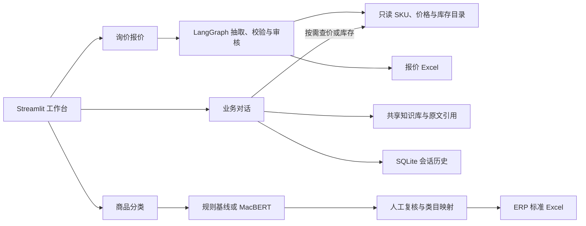

# 耗材工作台

耗材工作台是面向打印机耗材的本地业务系统，提供批量询价报价、耗材选型与售后问答、商品分类。系统内置示例商品、询价单和技术文档，价格与库存来自本地模拟 ERP。

## 快速开始

1. [下载 Windows x64 便携版](https://github.com/hufrrfhtd/Shangqiao_System/releases/latest/download/AI-Interview-Demo-windows-x64.zip)。
2. 将 ZIP 完整解压到有写入权限的目录。
3. 双击 `Run-Demo.cmd`，在浏览器中打开工作台。若浏览器没有自动打开，可访问终端显示的本地地址。

便携版内置 Python 和运行依赖，解压后即可离线使用。按 `Ctrl+C` 可停止本地服务。

## 功能与用法

### 询价报价

1. 在「业务助手」点击「进入询价」，上传 `.xlsx` 或 `.csv`，或直接使用内置的示例询价单。表格应包含商品描述或型号、数量，可补充品牌与兼容要求。
2. 点击「开始询价分析」。系统匹配 SKU，查询商品单价和库存，并标出需要人工核对的记录。
3. 有待审核记录时，在「人工审核」中逐行选择「确认报价」或「跳过」。确认的记录需要核对 SKU 和数量，同一 SKU 的合计数量会参与库存校验。审核完毕后点击「确认并生成报价」。
4. 报价生成后，点击「下载报价 Excel」。

### 业务对话

在「业务助手」点击「开始对话」，在右侧底部输入问题。左侧可新建对话、搜索历史会话，或打开旧会话继续提问。

| 可查询的内容 | 示例问题 |
| --- | --- |
| 耗材选型 | HP M404 可以用哪些硒鼓？ |
| 价格与库存 | CF258A 的价格和库存是多少？ |
| 故障排查与售后政策 | HP M404 卡纸怎么处理？如何申请退货？ |

选型与售后问题使用同一知识库。询问价格或库存时，系统会按需查询只读 ERP。回复下方可展开「查看检索排名与原文」。对话记录保存在本机的 `.runtime/chat_history.sqlite3`。

需要添加资料时，打开「检索设置」中的「管理知识库」，选择文档类型，上传可提取文字的 PDF、DOCX 或 TXT，再点击「更新知识库」。

### 商品智能分类

1. 在左侧选择「商品智能分类」，上传 `.xlsx` 或使用内置示例。标准列为「商品名称」「品牌」「商品规格」「供应商原始型号」。
2. 点击「清洗并分类」，查看预测类目、置信度和对应的 ERP 编码。
3. 在「人工复核」中确认或修正待复核商品的类目，补齐缺失的商品名称，再点击「下载 ERP 标准 Excel」。

如需评估分类效果，可在「标注数据评测」中使用内置测试集，或上传含「标注二级类目」列的测试表。

## 系统结构

工作台提供询价报价、业务对话和商品分类三条流程。报价和对话共用只读商品目录，售后问答和耗材选型共用一个知识库。报价审核与分类复核完成后分别导出 Excel。



## 核心技术

### 询价报价 Agent

| 环节 | 处理方式 |
| --- | --- |
| 表格解析 | 使用 Pandas 和 openpyxl 读取 Excel，也支持 CSV。规范化列名和全角字符，保留原始行号，便于从匹配结果回查询价单。 |
| 双路抽取 | LangGraph 并行运行规则抽取与 DeepSeek 抽取。规则识别型号、别名、品牌、类目和数量，支持「十二盒」等写法。启用 DeepSeek 时，模型以 JSON 返回抽取字段，Pydantic 校验结构、类型和数量范围。 |
| 交叉校验 | 两个分支结束后，`merge_check` 按原始行号汇总，核对标准化型号、数量和类目。结果缺失、冲突或存在歧义时，标记对应询价行待确认。模型未启用或请求失败时，流程继续使用规则结果并转人工审核。 |
| SKU 与库存核对 | 优先匹配精确型号，再查型号别名或打印机兼容关系。匹配时结合品牌、类目及原装或兼容要求。系统按 SKU 汇总需求数量，审核提交时重新校验库存。价格和库存取自 [模拟 ERP 商品目录](data/sku.csv)。 |
| 人工审核与计价 | 待确认记录通过 LangGraph 的 `interrupt()` 暂停。销售确认或跳过后，`Command(resume=...)` 使用同一个 `thread_id` 恢复流程。单行金额用 `Decimal` 计算单价乘以数量，再汇总金额并导出报价明细、审核记录和报价汇总。 |

例如，询价单中的「88A」可以通过别名匹配到标准耗材型号。若多行匹配到同一个 SKU，系统会汇总这些行的需求数量，再与可用库存核对。页面上的「流程详情与两路抽取结果」可查看规则结果、模型结果和匹配过程。 [报价工作流源码](quote_agent.py)

### 业务对话与 RAG

1. **识别请求并补齐信息**。规范化后命中 FAQ 或别名时，直接返回标准答案。故障排查缺少设备型号或故障现象时，助手先追问，再带着补齐的信息检索。例如先输入「卡纸了怎么办？」，再补充「HP M404」。涉及价格或库存时，业务规则会调用只读 ERP 查询，同一条回复可以同时显示维修依据和库存。 [业务路由源码](business_assistant.py)
2. **解析文档并保留出处**。解析 PDF、DOCX 和 TXT，按章节组织文本，再用 LangChain 递归切片。片段保留文档名、章节、适用机型、文档类型和片段 ID，PDF 还保留页码。售后手册、政策和产品兼容资料进入同一语料库，检索按问题类型和机型等条件筛选候选片段。 [文档解析源码](rag_engine.py)
3. **混合召回与排序**。BM25 用于匹配设备型号、耗材别名和故障关键词。配置 BGE 后，Chroma 用余弦相似度召回语义相近的片段。两路通过 RRF（倒数排名融合）合并排序，对每路命中的排名累加 `1 / (60 + rank)`。配置 BGE-Reranker 后，可对合并后的候选再精排。页面可展开查看排名、得分和原文。 [检索与排序源码](rag_engine.py)
4. **引用校验和证据不足处理**。启用 DeepSeek 时，模型从检索结果中挑选能回答问题的原文，代码校验引用编号与所引内容是否吻合。证据不足时提示联系售后核实。离线或 API 请求失败时，页面可以展示本地检索到的原文。 [引用校验源码](rag_engine.py)
5. **更新资料与恢复会话**。同类型的同名文件按 SHA-256 比较内容，变化时替换文件，Chroma 按片段 ID 补写缺失向量并清理过期记录。SQLite 保存提问、回复、引用、ERP 查询结果和追问上下文，左侧可按标题或消息内容搜索旧会话。历史中的库存和价格是当次查询记录，重新发送问题可获取目录中的当前值。 [会话持久化源码](chat_history.py)

### 商品智能分类

| 环节 | 处理方式 |
| --- | --- |
| 数据清洗 | 使用 Pandas 处理缺失值和重复商品，统一名称、品牌别名和规格字段。保留原始行号及供应商型号，便于人工复核和回查。 |
| 分类体系 | 固定维护 4 个一级类目和 18 个二级类目。预测或复核确认二级类目后，由配置查得一级类目和 ERP 编码。例如「黑色硒鼓」映射到「打印耗材」和 `SUP-103`。 [类目配置](data/categories.json) |
| 规则与模型推理 | 便携版按商品名称和规格中的关键词进行分类，以启发式得分辅助复核。可选的 MacBERT 模式用商品名称、品牌和规格组成输入，经 Transformers 和 PyTorch 在 CPU 上推理，输出 18 个二级类目的 Softmax 概率。 [分类源码](classifier.py) |
| 人工复核与导出 | 低于阈值、未判定或商品名称缺失的记录进入复核表。确认类目和补齐名称后重新映射 ERP 编码，Excel 包含标准数据和复核记录。 [分类页面源码](pages_ui/classification_page.py) |
| 离线训练与评测 | 内置训练集 54 条、独立测试集 36 条，均为虚构商品。训练脚本检查训练集与测试集是否含有相同输入文本。评测计算 Accuracy、Macro-F1 和混淆矩阵，结果用于验证该样例上的训练与评测流程。 [训练脚本](train_macbert.py) |

## 组件选型与运行边界

本仓库采用适合单机运行的组件。下表列出这些组件承担的职责，以及服务化项目中对应的技术环节。

| 环节 | 本仓库实现 | 服务化项目中的对应职责 |
| --- | --- | --- |
| 应用入口 | Streamlit 提供上传、对话、审核和导出页面 | FastAPI 对外提供问答、文档管理、分类预测和审核接口 |
| 知识检索 | 本地 BM25，可选 BGE 向量、Chroma 与 BGE-Reranker | BGE-M3 生成向量，Milvus 保存和检索向量，Reranker 对候选精排 |
| 业务数据与状态 | 本地 CSV 提供价格和库存，进程内检查点保存待审核报价，SQLite 保存会话 | ERP 提供权威商品数据，PostgreSQL 可存储工作流状态，MySQL 可记录文档版本与分类修正，Redis 可承担版本化缓存 |
| 质量评测 | 自动化测试覆盖询价审核、检索、引用和分类导出，分类页面计算标注测试集指标 | RAGAS 与人工审核可评估检索和回答质量，业务标注集可评估抽取、匹配及分类效果 |

便携版自带 BM25 检索、FAQ、模拟 ERP 查询、报价审核和规则分类。DeepSeek、BGE、MacBERT 通过源码环境启用。报价检查点随应用进程保存，服务重启后需重新发起待审核批次。已保存的业务对话可以从历史列表恢复。

## 从源码运行与开启可选功能

下载源码后也可以双击 `Run-Demo.cmd`。首次启动会联网准备 Python 和运行依赖。此方式和便携版均默认使用本地 BM25 检索与规则分类。

需要启用 DeepSeek、BGE 或 MacBERT 时，先安装 uv，再在源码目录创建运行环境并按本节末尾的命令启动。 [uv 安装说明](https://docs.astral.sh/uv/getting-started/installation/)

```powershell
uv venv --python 3.11 .venv
uv pip install --python .venv/Scripts/python.exe -r requirements.txt
if (-not (Test-Path '.env')) { Copy-Item '.env.example' '.env' }
```

- **DeepSeek** 支持询价信息抽取和带引用的问答。在 `.env` 填写 `DEEPSEEK_API_KEY`。启用后，查询或抽取所需的内容会发送到配置的 API。
- **BGE** 支持向量检索和重排序。默认向量模型为 `BAAI/bge-small-zh-v1.5`，可由 `BGE_MODEL` 切换到 `BAAI/bge-m3` 或已有的本地权重目录。安装下方模型依赖后，首次联网下载权重时在 `.env` 设置 `RAG_ALLOW_MODEL_DOWNLOAD=1`。可选的精排模型通过 `BGE_RERANKER_MODEL` 设置。
- **MacBERT** 支持查看 18 个二级类目的模型概率。安装模型依赖后运行 `train_macbert.py` 生成分类权重。首次训练会下载基础模型，也可用 `--base-model` 指定本地模型目录。

```powershell
# 使用 BGE 或 MacBERT 时安装
uv pip install --python .venv/Scripts/python.exe --index-url https://download.pytorch.org/whl/cpu "torch>=2.6,<3"
uv pip install --python .venv/Scripts/python.exe -r requirements-models.txt

# 使用 MacBERT 时训练
& .\.venv\Scripts\python.exe train_macbert.py
```

配置完成后，在项目目录运行以下命令。

```powershell
& .\.venv\Scripts\python.exe -m streamlit run app.py --server.address 127.0.0.1
```
