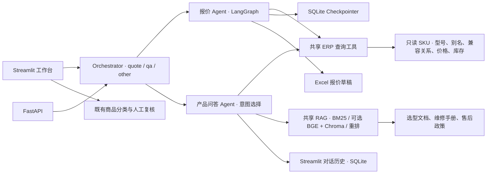
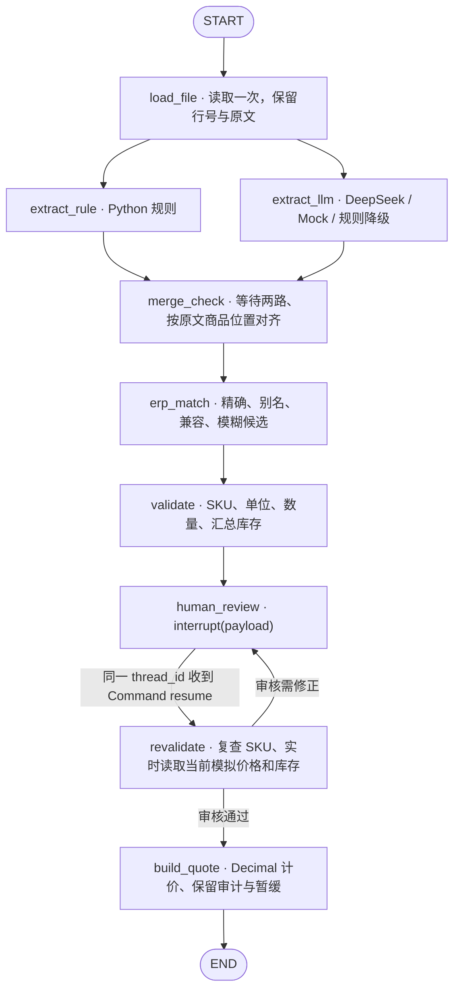

# 耗材工作台 · 询价报价智能 Agent

面向打印耗材 B2B 分销的本地 Demo。销售可以上传 Excel / CSV 或粘贴文本，核对规则与模型的抽取结果、候选 SKU、价格和库存，经人工审核生成 Excel 报价草稿。业务对话可以查询耗材选型、兼容关系、价格、库存和售后。原有的商品智能分类、人工复核和 ERP 标准 Excel 导出也可继续使用。

## 快速启动

需要 Python 3.11。在项目目录运行以下命令。Windows 也可以双击 `Run-Demo.cmd`，源码首次启动会联网安装依赖。

```powershell
py -3.11 -m venv .venv
& .\.venv\Scripts\python.exe -m pip install -r requirements.txt
if (-not (Test-Path '.env')) { Copy-Item '.env.example' '.env' }
& .\.venv\Scripts\python.exe -m streamlit run app.py --server.address 127.0.0.1
```

使用 uv 时可执行 `uv venv --python 3.11 .venv` 和 `uv pip install --python .venv/Scripts/python.exe -r requirements.txt`。浏览器打开 [Streamlit 工作台](http://127.0.0.1:8501)。

FastAPI 提供同一业务服务的 HTTP 入口。界面可独立启动。需要调试 API 时，在另一个终端执行以下命令。

```powershell
& .\.venv\Scripts\python.exe -m uvicorn api:app --host 127.0.0.1 --port 8000
```

打开 [FastAPI 接口文档](http://127.0.0.1:8000/docs)。`POST /assist` 接收文本并返回意图和处理结果，`POST /quotes/upload` 接收文件，`GET /quotes/{inquiry_id}` 恢复查看任务，`POST /quotes/{inquiry_id}/review` 接收当前 `interrupt_id` 与审核决定，`GET /quotes/{inquiry_id}/workbook` 下载 Excel。问答中的追问上下文可通过 `context` 字段往返。

### 配置与数据

| 环境变量或文件 | 用途 |
| --- | --- |
| `DEEPSEEK_ENABLED`、`DEEPSEEK_API_KEY` | 设为启用并填写 Key 后可选择真实 DeepSeek 模式。设为 `0` 可强制离线。 |
| `DEEPSEEK_MODEL`、`DEEPSEEK_BASE_URL` | 复用现有 DeepSeek 模型名与 API 地址，按账号可用配置填写。启用真实抽取后会把询价行发送给 API。 |
| `QUOTE_DB_PATH` | 默认 `.runtime/quote_checkpoints.sqlite3`。首次使用会自动建表，两入口使用同一路径即可共享报价状态。 |
| `data/sku.csv` | 本地只读模拟 ERP，包含既有示例耗材和新增的 A001–A006。 |
| `data/quotation_demo.xlsx` | 页面默认示例，包含重复 SKU 需求、多候选、错写型号、库存不足、原文未覆盖及 Mock 数量冲突。 |
| `data/selection/`、`data/after_sales/` | 本地知识库随项目提供。可在「检索设置」上传 PDF、DOCX 或 TXT。 |
| `BGE_MODEL`、`BGE_RERANKER_MODEL`、`RAG_ALLOW_MODEL_DOWNLOAD` | 可选向量与重排配置，参考 `.env.example`。默认流程可以用本地 BM25。 |
| `MACBERT_MODEL_DIR` | 可选的商品分类模型目录。 |

报价 checkpoint 和原有对话历史 `.runtime/chat_history.sqlite3` 分别保存。旧版报价检查点存在内存中，新版本部署后需重新发起其中未完成的任务。当前应用和 API 面向单机演示，使用任务 ID 恢复本机记录。处理真实客户数据时需另配身份鉴别、数据访问控制和保留策略。

需要运行 BGE、Chroma、BGE-Reranker 或训练 MacBERT 时，再安装模型依赖。首次联网获取权重时可以设置 `RAG_ALLOW_MODEL_DOWNLOAD=1`。

```powershell
uv pip install --python .venv/Scripts/python.exe --index-url https://download.pytorch.org/whl/cpu "torch>=2.6,<3"
uv pip install --python .venv/Scripts/python.exe -r requirements-models.txt
# 使用 MacBERT 时可训练样例权重
& .\.venv\Scripts\python.exe train_macbert.py
```

## 分层架构



上传文件直接进入报价。自然语言根据询价清单、报价动作和已有问答上下文路由。查单价或库存属于问答，带数量的正式报价请求优先走报价。问答中的知识与价格可以同时使用 RAG 和 ERP。

## 报价 LangGraph



| 代码入口 | 负责的工作 |
| --- | --- |
| `QuoteState` / `load_file` | 保存任务 ID、文件名、原始行和各节点结果。Pandas 读取第一张 Excel 工作表或 CSV。文本按行保留来源。 |
| `extract_rule` | 用已知型号、别名、列映射、正则和中文数字转换抽取型号、数量、单位与原装/兼容要求。 |
| `extract_llm` | 使用 Pydantic 约束 JSON 响应，保留缺失值与来源位置。真实调用有限重试，失败行转人工核对。未配置服务时可用标记为 Mock 的本地演示分支。 |
| `merge_check` | 用行号、规整型号、原文跨度和出现顺序对齐。保留两路候选、冲突、漏项和原文覆盖异常。结果一致时进入待 ERP 核验状态。 |
| `erp_match` / `validate` | 区分查无型号、仅模糊候选和目录查询失败。精确匹配可能有多个 SKU，规则按品牌、品类与原装/兼容条件收窄。库存按 SKU 汇总。 |
| `human_review` / `revalidate` | 销售可以确认、修订或暂缓。提交后按同一任务恢复工作流，从最新目录重新核验数量、单位、SKU 和价格。错误返回审核页。 |
| `build_quote` | 读取复核后的价格快照，使用 `Decimal` 计算小计和合计，保留来源型号与所选 SKU 的对应关系。预览和导出包含暂缓条目及审核记录。 |

`items_rule` 与 `items_llm` 由并行分支分别写入。人工审核节点中断前只准备 payload。服务使用同一个询价 ID 作为 `thread_id`，在任务锁内检查中断 ID 和完成状态，重复提交返回已有草稿。草稿 ID 由任务 ID 确定。报价仅供销售确认和导出，ERP 模拟目录全程只读。 [工作流](quote_agent.py) · [抽取与交叉验证](quote_extraction.py) · [恢复与导出](quote_service.py)

### 人工审核与技术执行详情

「查看全部」可以检查绿色预填项。「只看异常」聚焦黄色待复核与红色未识别或无法核验的条目。销售可确认 SKU、数量、单位和原装/兼容条件。修改或暂缓时填写原因。审核记录保留修改前后、条目编号、原始行号、处理状态和时间。缺少单位时，独立匹配到 SKU 的条目可预填 ERP 件数单位，销售可修正。当前样例目录按件计库存，未提供包装换算。

关闭页面后，在询价页用任务 ID 恢复已保存的审核状态。未提交的表格编辑保存在当前页面会话，恢复任务时以检查点中的结果为准。页面中的「技术执行详情」展示节点、抽取差异、状态、ERP 工具参数和结果、HITL 暂停与恢复和节点耗时。客户原文在业务审核表中查看，调试视图对客户字段进行脱敏。

## 问答与真实性

| 环节 | 运行方式 |
| --- | --- |
| 真实 LLM | 启用并选用 DeepSeek 时发出真实 API 调用。抽取响应进行结构和来源验证；知识回答引用经校验的片段。 |
| Mock LLM | 本地演示分支。示例行 `CN303 五个（演示数量冲突）` 可稳定重现规则 5 与 Mock 50 的冲突。 |
| 规则降级 | 真实调用失败后，对受影响商品保留规则结果和待核对提示。API 也支持显式选择 `rules`。 |
| 模拟 ERP | 报价与问答查询同一份本地 SKU 目录。价格、库存及兼容关系均为演示数据，真实 ERP 接入留作扩展。 |
| 本地知识检索 | 对实际文档切片执行 BM25 检索，保留文档名、章节及原文引用。FAQ 命中时使用独立的固定答案路径。 |
| 可选向量与重排 | 配置 BGE 模型后可使用 Chroma 向量召回，与 BM25 结果通过 RRF 融合。配置 BGE-Reranker 后可选精排。当前未部署 Milvus。 |

示例可问「HX-259A 原装多少钱？还有多少库存？」「HX-259A 适用于什么打印机？」「HX-259A 和 HX-259X 有什么区别？分别多少钱？」。问答按型号过滤相关资料，混合问题同时返回货号、价格、库存和所引用的证据。证据不足时提示核实。 [问答调度](business_assistant.py) · [ERP 工具](erp_tools.py) · [知识检索](rag_engine.py)

### 商品智能分类

在左侧选择「商品智能分类」，上传 Excel 或使用内置示例。标准列为「商品名称」「品牌」「商品规格」「供应商原始型号」。点击「清洗并分类」查看预测类目、置信度和 ERP 编码。在「人工复核」确认或修正待复核商品并补齐名称，再点击「下载 ERP 标准 Excel」。

工作台维护 4 个一级类目、18 个二级类目，默认使用规则基线，可启用本地 MacBERT。「标注数据评测」支持内置测试集或包含「标注二级类目」列的表格，计算 Accuracy、Macro-F1 和混淆矩阵。 [分类页面](pages_ui/classification_page.py) · [类目配置](data/categories.json)

## 3–5 分钟面试演示

1. 在业务助手进入询价，下载并上传页面提供的样例，或直接启动默认示例。选择 Mock LLM 后点击「开始询价分析」。约 40 秒。
2. 展开「技术执行详情」。说明同一份原始行分给两个 LangGraph 分支。检查 CN303 的 5 对 50、同一单元格中的两个商品和两路未覆盖的原文。约 50 秒。
3. 打开「只看异常」。按原文确认 CN303 数量 5，选择 A003。LK-2441 改为 50 支。PX-428 选择 A001 标准容量，保留 20 个。HX-295A 和无型号的原文暂缓并填备注。若需要展示持久化，复制任务 ID 后在新页恢复再提交。约 90 秒。
4. 提交后检查 A001 的 10 + 20 按库存 30 校验。预览合计 ¥32,130.00 的草稿，并下载 Excel 查看「暂缓条目」与「审核记录」。约 35 秒。
5. 返回业务助手，先问「HX-259A 原装多少钱？还有多少库存？」，再问「HX-259A 和 HX-259X 有什么区别？分别多少钱？」。查看实际查询到的模拟 ERP 行和知识来源。约 45 秒。

## 修改文件

| 文件 | 修改内容 |
| --- | --- |
| `quote_agent.py`、`quote_extraction.py` | 扩展 LangGraph 状态图，补齐文件和文本解析、并行抽取、按商品对齐及复核闭环。 |
| `quote_service.py`、`api.py` | 新增 SQLite 检查点、任务恢复、提交幂等、Excel 导出和 FastAPI 入口。 |
| `erp_tools.py`、`orchestrator.py`、`business_assistant.py`、`rag_engine.py` | 复用并提取 ERP 工具，增加候选匹配、统一入口路由和型号过滤后的问答。 |
| `chat_history.py` | 调整商品数据类的导入，继续读取既有 SQLite 对话记录。 |
| `app.py`、`pages_ui/quote_page.py`、`pages_ui/rag_page.py` | 保留 Streamlit 入口，补齐文本报价、审核对照、技术面板和对话到报价的转交。 |
| `data/quotation_demo.xlsx`、`data/sku.csv`、`data/selection/演示耗材选型指南.txt` | 增加可重复的询价数据、模拟 SKU 和选型知识依据。 |
| `.env.example`、`requirements.txt`、`scripts/build_portable.py`、`scripts/requirements-portable-win-x64.txt` | 增加检查点配置、依赖及便携版打包文件。 |
| `tests/test_quote_extraction.py`、`tests/test_quote_service.py`、`tests/test_quote_page.py`、`tests/test_erp_qa_routes.py` | 通过处理函数、图状态、接口及 Streamlit 页面验证演示场景。 |
| `README.md` | 记录运行命令、架构与工作流、面试步骤和实测边界。 |

## 验证与限制

```powershell
$env:DEEPSEEK_ENABLED = '0'
uv pip install --python .venv/Scripts/python.exe pytest
& .\.venv\Scripts\python.exe -m pytest -q
```

- 全量自动化测试通过 37 项及 16 项子测试。覆盖原有分类、问答、会话恢复，以及报价双路抽取、ERP 匹配、审核阻断与修复、SQLite 重开、并发重复提交、Excel 导出和 API 路由。模型错误与超时由可控接口替身触发。
- 实际启动 Streamlit 和 FastAPI，健康检查均返回 HTTP 200。示例 Excel 端到端生成 ¥32,130.00 报价草稿，保留 2 个暂缓条目。
- 使用已配置的 DeepSeek API 对一条合成询价执行真实抽取，得到同一行的两条商品。用本地 BM25 和模拟 ERP 验证混合问答的出处与 SKU。本次验证使用有限样例。

当前演示支持首张表、最多 200 条来源行，支持明确的数量，区间、约数、包装换算和没有依据的型号需人工核对。报价与知识咨询混合的复杂请求采用报价优先，可拆成两次提交。价格来自目录，客户协议价、阶梯价、真实 ERP、Milvus 和生产级任务隔离留作扩展。
